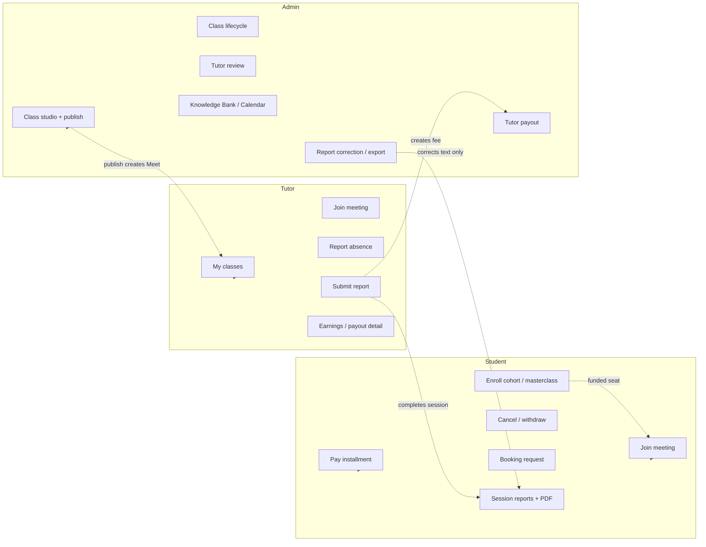
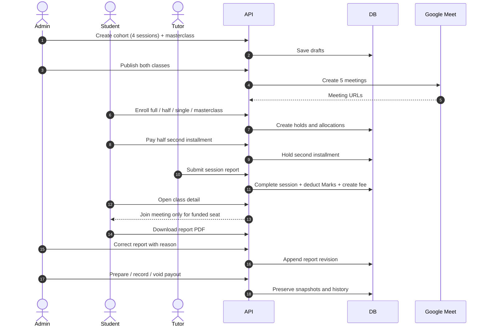
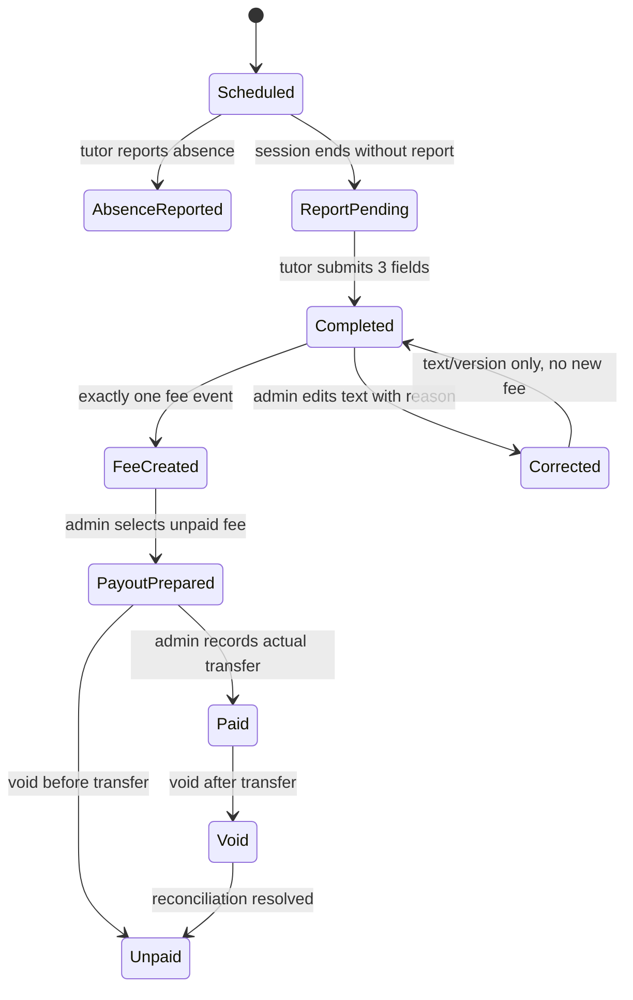
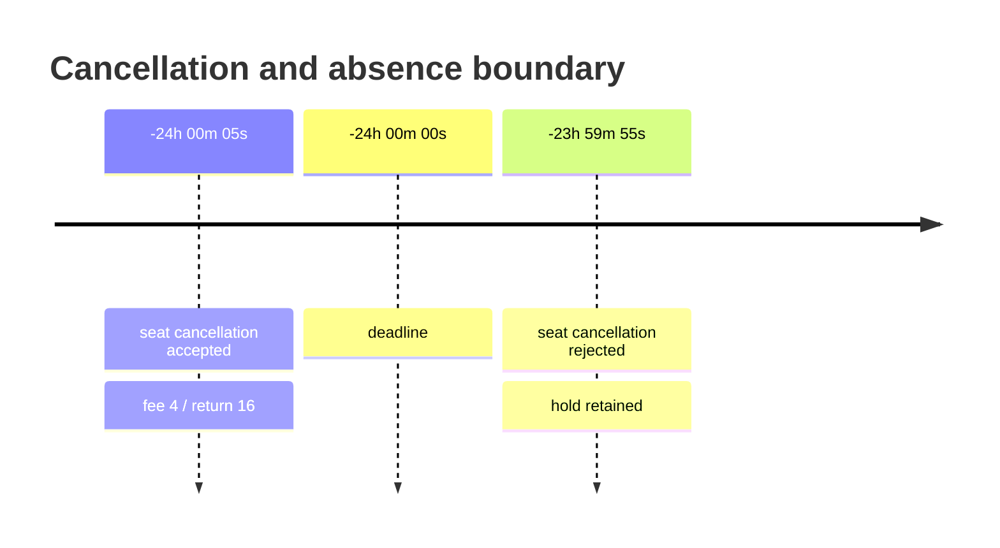
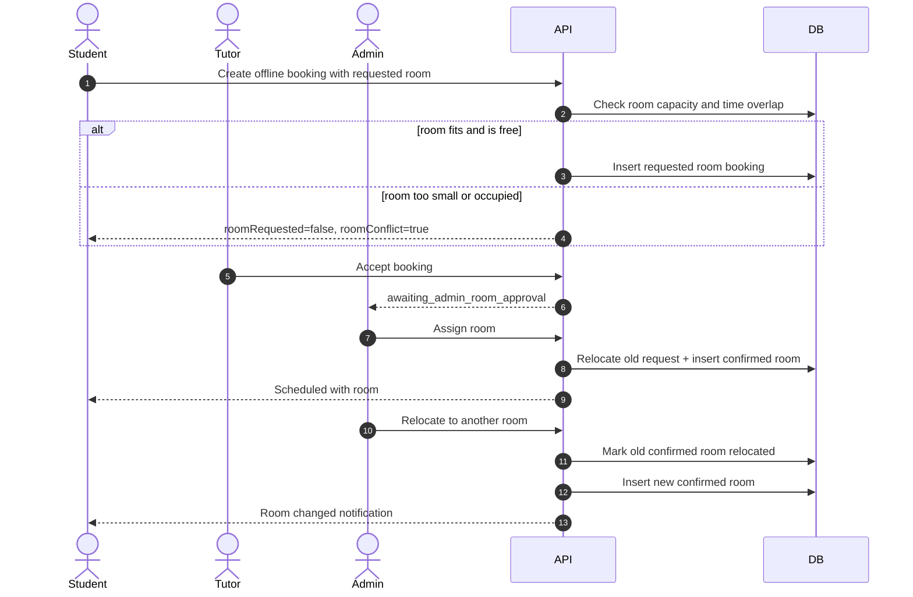

# V3 automated UAT evidence

Date: 1 November 2026.

Scope: automated and semi-automated verification of Release V3 across student,
tutor, and admin roles. This is internal evidence, not client UAT acceptance.
The final-scope PDF comparison is in
[FINAL-SCOPE-V3-GAP-ANALYSIS.md](FINAL-SCOPE-V3-GAP-ANALYSIS.md).

Environment:

- Web: `http://localhost:3000`
- API: `http://localhost:3001`
- Database: development PostgreSQL on `localhost:6767/cogito-app`
- Seed accounts: Andre (student), Argya (student), Athena (student), Diego
  (tutor), Admin User (admin)
- Browser: installed Microsoft Edge through Playwright
- Payment, OTP mail, Google OAuth consent, and KOL transfers were not executed

The database was not reset. Test fixtures were created and retained for
inspection. Session timestamps were moved into the past with SQL only where a
completion report required it.

## Result summary

| Measure                                          | Result |
| ------------------------------------------------ | -----: |
| User stories reviewed                            |     56 |
| Stories with a reachable app path                |     56 |
| Stories covered by surface or transaction checks |     46 |
| Stories still partial                            |     10 |
| Stories missing a path                           |      0 |
| Functional checkpoints exercised                 |     34 |
| Offline room checks                              |     10 |
| Negative and edge cases exercised                |     26 |
| Time boundary checks                             |     10 |
| Report replay checks                             |      1 |
| Payout lifecycle checks                          |      5 |

Coverage legend:

- **Covered**: role can reach the story and the main path was observed.
- **Partial**: one acceptance condition remains provider-bound, finance-bound, or
  not exercised.
- **Missing**: role has no working app path.

## Coverage map

## Main functional flows

## Report and payout state flow

## Role route walkthrough

Each route was opened with the seeded role account. No redirect loops or blank
screens were observed on the primary paths.

| Role    | Routes reached                                                                                                                                                                                                                                                                                                                                               | Result |
| ------- | ------------------------------------------------------------------------------------------------------------------------------------------------------------------------------------------------------------------------------------------------------------------------------------------------------------------------------------------------------------ | ------ |
| Student | `/dashboard`, `/balance`, `/tutors`, `/tutors/:id/book`, `/classes`, `/classes/:id`, `/bookings`, `/bookings/:id`, `/class-reports`, `/referrals`, `/achievements`, `/profile`, `/notifications`, `/guide`, `/calendar`, `/knowledge-bank`, `/faq`                                                                                                           | Pass   |
| Tutor   | `/dashboard`, `/my-classes`, `/my-classes/:id`, `/bookings`, `/bookings/:id`, `/class-reports`, `/availability`, `/profile`, `/notifications`, `/guide`, `/calendar`, `/knowledge-bank`, `/faq`                                                                                                                                                              | Pass   |
| Admin   | `/admin`, `/admin-operations`, `/bookings`, `/classes/:id`, `/admin-classes`, `/class-reports`, `/admin-tutors`, `/admin-tutors/:id`, `/admin-tutor-payouts`, `/admin-referrals`, `/admin-economy`, `/admin-competitions`, `/admin-achievements`, `/admin-knowledge-bank`, `/faq`, `/activities`, `/notifications`, `/guide`, `/calendar`, `/knowledge-bank` | Pass   |

## Functional flow list

| ID  | Flow                                                | Evidence                                                                                           | Result            |
| --- | --------------------------------------------------- | -------------------------------------------------------------------------------------------------- | ----------------- |
| F01 | Student, tutor, admin sign-in and route walkthrough | Each seed account reached its dashboard; role routes and sidebar groups matched                    | Pass              |
| F02 | Create 4-session cohort                             | Class 137, "V3 Acceptance Cohort - Multi Session"; 4 sessions, capacity 10, online, Diego assigned | Pass              |
| F03 | Create masterclass                                  | Class 138, "V3 Acceptance Masterclass"; exactly 1 session, 5-Mark rate                             | Pass              |
| F04 | Publish classes and create meetings                 | 4 cohort Meet URLs + 1 masterclass Meet URL; all status `created`                                  | Pass              |
| F05 | Full enrollment                                     | Andre: 80 Marks held across 4 sessions                                                             | Pass              |
| F06 | Half enrollment                                     | Argya: 3 sessions, 44 first installment + 22 second installment                                    | Pass              |
| F07 | Single enrollment                                   | Athena: 25 Marks held for one session                                                              | Pass              |
| F08 | Masterclass enrollment                              | Andre: 5 Marks held for one session                                                                | Pass              |
| F09 | Second installment payment                          | Argya paid 22; action removed after payment                                                        | Pass              |
| F10 | Single-seat cancellation                            | Athena: fee 5, return 20; final 195 available / 0 held / 195 total                                 | Pass              |
| F11 | Half-plan withdrawal                                | Argya: fee 4, return 18; final 127 available / 47 held / 174 total                                 | Pass              |
| F12 | Booking create and accept                           | Booking 22: 38 held, tutor accepted, meeting created                                               | Pass              |
| F13 | Booking completion                                  | Booking 22 report submitted; 38 deducted; one Rp160,000 fee                                        | Pass              |
| F14 | Booking cancellation                                | Booking 23: 38 held, tutor accepted, cancelled more than 24h before start; full 38 returned        | Pass              |
| F15 | Class reports                                       | Cohort S1/S4, masterclass, private booking each created one report and one fee                     | Pass              |
| F16 | Report replay                                       | Identical request returned same report ID; fee count stayed 1; wallets unchanged                   | Pass              |
| F17 | Tutor My Classes                                    | 7 assigned sessions; detail shows curriculum, format, Join meeting, report link                    | Pass              |
| F18 | Pre-start absence                                   | CLS-137-S2 notice recorded without late label; admin history visible                               | Pass              |
| F19 | Late absence                                        | CLS-137-S3 notice recorded as late; admin history visible                                          | Pass              |
| F20 | Student report list and PDF                         | 6 eligible reports; download produced valid PDF                                                    | Pass              |
| F21 | Admin report export                                 | `student-reports-2026-11-01.pdf`, 36,598 bytes, `%PDF-`                                            | Pass              |
| F22 | Admin report correction                             | CLS-137-S4 version 1 tutor → version 2 admin; reason stored; fee/wallet unchanged                  | Pass              |
| F23 | Max-length report PDF                               | Corrected report: 36,402 bytes, one page                                                           | Pass              |
| F24 | Knowledge Bank upload/view                          | Private PDF; student 200 `application/pdf`; anonymous 401                                          | Pass              |
| F25 | KB category label                                   | Card, filter, viewer show "Essay & Writing" instead of raw ID                                      | Pass              |
| F26 | Calendar event                                      | "V3 Acceptance Competition", 20-21 Nov 2026, visible in student month grid                         | Pass              |
| F27 | Payout prepare                                      | 4 fees, gross Rp1,260,000, tax Rp37,800, net Rp1,222,200                                           | Pass              |
| F28 | Payout record                                       | Actual Rp1,222,200, reference `UAT-DEV-NO-BANK-TRANSFER`; status paid                              | Pass              |
| F29 | Payout void after transfer                          | Status void; four sources held for reconciliation                                                  | Pass              |
| F30 | Payout reconciliation                               | Resolve returned four sources to unpaid                                                            | Pass              |
| F31 | Payout void before transfer                         | New prepared payout voided; four sources returned immediately                                      | Pass              |
| F32 | Late private cancellation                           | Booking 24: 38 held, tutor accepted, cancelled under 24h; full 38 returned, total unchanged        | Pass, policy note |
| F33 | KB access grant                                     | Admin created, listed, and removed a temporary Athena grant with expiry and note                   | Pass              |
| F34 | Calendar duplicate title/date                       | Two distinct events with same title/dates listed twice; second event removed                       | Pass              |

## Negative and edge case list

```mermaid
flowchart TD
  N1[Anonymous request] --> D1[401]
  N2[Student to admin API] --> D2[403]
  N3[Tutor to admin API] --> D3[403]
  N4[Tutor to student API] --> D4[403]
  N5[Student to tutor API] --> D5[403]
  N6[Booking conflict] --> D6[409]
  N7[Past booking] --> D7[400]
  N8[Unknown specialization] --> D8[400 clear message]
  N9[Duplicate enrollment] --> D9[409 + wallet unchanged]
  N10[Overlapping entitlement] --> D10[409]
  N11[Wrong plan] --> D11[400]
  N12[Report before end] --> D12[400]
  N13[Empty report field] --> D13[400]
  N14[Report over 600] --> D14[400]
  N15[Duplicate absence] --> D15[409]
  N16[Stale class publish] --> D16[409]
  N17[Masterclass with 2 sessions] --> D17[400]
  N18[Stale KB update] --> D18[409]
  N19[Notification IDOR] --> D19[404 + victim unread]
  N20[Cancelled student meeting access] --> D20[empty result]
  N21[Anonymous KB file] --> D21[401]
  N22[Cancel completed booking] --> D22[409]
  N23[Report replay] --> D23[same report + one fee]
```

| ID  | Case                                           | Expected             | Observed                                | Result            |
| --- | ---------------------------------------------- | -------------------- | --------------------------------------- | ----------------- |
| N01 | Anonymous wallet read                          | 401                  | 401 UNAUTHORIZED                        | Pass              |
| N02 | Student calls admin class list                 | 403                  | 403 FORBIDDEN                           | Pass              |
| N03 | Tutor calls admin class list                   | 403                  | 403 FORBIDDEN                           | Pass              |
| N04 | Student calls admin booking list               | 403                  | 403 FORBIDDEN                           | Pass              |
| N05 | Student calls admin content update             | 403                  | 403 FORBIDDEN                           | Pass              |
| N06 | Tutor calls student-only enrollment read       | 403                  | 403 FORBIDDEN                           | Pass              |
| N07 | Student calls tutor-only absence write         | 403                  | 403 FORBIDDEN                           | Pass              |
| N08 | Booking at occupied time                       | 409                  | 409 Booking time conflict               | Pass              |
| N09 | Booking start in the past                      | 400                  | 400 validation failure                  | Pass              |
| N10 | Booking with unknown specialization            | 400                  | 400 supported topic required            | Pass              |
| N11 | Duplicate full enrollment                      | No new hold          | 409 active enrollment; wallet unchanged | Pass              |
| N12 | Single plan on full-plan session               | Conflict             | 409 active enrollment                   | Pass              |
| N13 | Full plan on masterclass                       | Validation failure   | 400 choose masterclass plan             | Pass              |
| N14 | Report before session end                      | Validation failure   | 400 only after session ends             | Pass              |
| N15 | Empty report field                             | Validation failure   | 400                                     | Pass              |
| N16 | Report field over 600 characters               | Validation failure   | 400                                     | Pass              |
| N17 | Student submits class report                   | Denied               | 404 class enrollment not found          | Pass, safe denial |
| N18 | Duplicate absence notice                       | Conflict             | 409 notice already exists               | Pass              |
| N19 | Publish with stale class version               | Conflict             | 409 reload and review                   | Pass              |
| N20 | Masterclass with two sessions                  | Validation failure   | 400                                     | Pass              |
| N21 | Stale Knowledge Bank update                    | Conflict             | 409 reload and review                   | Pass              |
| N22 | Student marks another user's notification read | Not found            | 404; victim stayed unread               | Pass              |
| N23 | Cancelled student requests unreported sessions | Empty                | 200 `[]`; no meeting data               | Pass              |
| N24 | Anonymous Knowledge Bank file                  | 401                  | 401                                     | Pass              |
| N25 | Cancel completed booking                       | Conflict             | 409 invalid state transition            | Pass              |
| N26 | Replay identical class report                  | Same report, one fee | Same ID; fee count 1; wallets unchanged | Pass              |

## Financial invariants observed

| Invariant                                | Evidence                                                     |
| ---------------------------------------- | ------------------------------------------------------------ |
| Wallet total never included a hold twice | Booking 22: 491 total before and after the 38 hold           |
| One report creates one fee               | Session 4: fee count 0 → 1; replay kept it at 1              |
| One report deducts once                  | Andre 491 → 491 after replay; held 141 stayed                |
| Duplicate enrollment does not hold again | Wallet 511/161/350 before and after rejected duplicate       |
| Cancellation returns exact Marks         | Athena fee 5 + return 20; Argya fee 4 + return 18            |
| Payout snapshots do not recalculate      | Prepared/recorded gross 1,260,000, tax 37,800, net 1,222,200 |
| Void after transfer blocks repayment     | Pending sources 0 until reconciliation resolved              |
| Void before transfer returns sources     | Pending sources returned to 4 immediately                    |

## Time boundary checks

| ID  | Boundary                                     | Expected                          | Observed                                                                                               | Result  |
| --- | -------------------------------------------- | --------------------------------- | ------------------------------------------------------------------------------------------------------ | ------- |
| T01 | Class seat cancellation at 24h + 5s          | 20% fee, return the rest          | Fee 4, return 16 on a 20-Mark seat                                                                     | Pass    |
| T02 | Class seat cancellation at 23h 59m 55s       | Seat stays held for completion    | 400 "No cancellable future seats remain"; no Marks changed                                             | Pass    |
| T03 | Tutor absence at 24h + 5s                    | Not late                          | Notice stored with `late=false`                                                                        | Pass    |
| T04 | Tutor absence at 23h 59m 55s                 | Late                              | Notice stored with `late=true`                                                                         | Pass    |
| T05 | Checkout reservation at 15 minutes           | Expiry blocks funding             | Initial expiry was +15m; after forcing it past, checkout returned `expired` and state became `expired` | Pass    |
| T06 | Class report before session end              | Rejected                          | 400 "only after the session ends"                                                                      | Pass    |
| T07 | Private booking cancellation under 24h       | Depends on legacy policy          | Full 38 returned; policy confirmation open                                                             | Observe |
| T08 | Second installment 7-day / 1-day reminders   | Reminder at both points           | Not executed                                                                                           | Open    |
| T09 | 72-hour minimum-enrollment postponement exit | Penalty-free exit                 | Not executed                                                                                           | Open    |
| T10 | Ordinary schedule-change exit deadline       | min(notification +24h, new start) | Not executed                                                                                           | Open    |

The two class-seat quotes used the same funded 20-Mark seat. The session start was
moved to `now + 24h + 5s` and `now + 23h 59m 55s`, then restored. This proves the
strict boundary behavior without charging Marks.

## Offline room checks

| ID  | Case                                        | Expected               | Observed                                                            | Result                  |
| --- | ------------------------------------------- | ---------------------- | ------------------------------------------------------------------- | ----------------------- |
| R01 | Admin creates small and large rooms         | Active room list       | Small capacity 1, large capacity 10                                 | Pass                    |
| R02 | Solo offline booking requests small room    | Room requested         | `roomRequested=true`, state awaiting tutor review                   | Pass                    |
| R03 | Tutor accepts offline booking               | Awaiting room approval | `awaiting_admin_room_approval`                                      | Pass                    |
| R04 | Admin assigns small room                    | Booking scheduled      | `scheduled`; confirmed room row created                             | Pass                    |
| R05 | Admin relocates to large room               | Old room freed         | Old row `relocated`; new row `confirmed` in large room              | Pass                    |
| R06 | Check large room at same time               | Occupied               | `available=false`                                                   | Pass                    |
| R07 | Group of 2 requests capacity-1 room         | No room request        | `roomRequested=false`, `roomConflict=true`, no room row             | Pass after capacity fix |
| R08 | Class session capacity 5 in capacity-1 room | Rejected               | 400 "Session capacity exceeds the selected room's capacity"         | Pass                    |
| R09 | Assign capacity-1 room to group of 2        | Rejected               | Unit test returns room capacity error; no confirmed row             | Pass by test            |
| R10 | All rooms occupied at one time              | Conflict               | Not fully exercised; requires a second tutor to avoid tutor overlap | Open                    |

Room capacity is validated in three places: booking creation, admin assignment,
and admin relocation. A requested row is marked `relocated` when admin assigns a
confirmed room, so the old request does not remain active.

## Fixture inventory

| Item                     | Identity / result                                                                                                                               |
| ------------------------ | ----------------------------------------------------------------------------------------------------------------------------------------------- |
| Cohort                   | Class 137, 4 sessions, 4 Meet URLs                                                                                                              |
| Masterclass              | Class 138, 1 session, 1 Meet URL                                                                                                                |
| Booking 22               | Solo, 38 held, completed, one fee                                                                                                               |
| Booking 23               | Solo, 38 held, accepted, cancelled, full return                                                                                                 |
| Booking 24               | Solo, 38 held, accepted, cancelled under 24h, full return; policy note                                                                          |
| KB grant                 | Athena grant `4a0673d3-4ed2-4c49-b7d2-d93936734c34`, created/listed/removed                                                                     |
| Calendar duplicate       | Event `a751c2b4-37eb-4037-a0ab-ecdba3915a82`, same title/dates; visible as distinct then removed                                                |
| Time boundary class      | Class 139, 2 online sessions, used for 24h absence checks                                                                                       |
| Checkout timeout class   | Masterclass `d708f44f-fbf2-4b90-b3b2-9f048d0b3bd5`; Athena enrollment `f3873d55-b476-4c27-93d6-d43b66d6055c` expired                            |
| Rooms                    | Small `c5c55156-314c-4cc3-8e33-e7dfa2e0fa1a` capacity 1; Large `8034be98-0bae-40c4-a293-b2da8bdb2f66` capacity 10                               |
| Offline booking          | Booking `6454da11-f5f6-450a-8538-7ab3a614e3a6`; requested small, assigned small, relocated large                                                |
| Stale request check      | Booking `b94594e1-2655-494e-bbc7-6a9736dc6b84`; requested small, admin assigned small, old request row became `relocated`                       |
| Cohort full enrollment   | 80 held, S1 and S4 completed                                                                                                                    |
| Cohort half enrollment   | 66 total, both installments paid, withdrawn with fee 4 / return 18                                                                              |
| Cohort single enrollment | 25 held, cancelled with fee 5 / return 20                                                                                                       |
| Masterclass enrollment   | 5 held and completed                                                                                                                            |
| Knowledge Bank           | Resource `bbd4b8ef-5957-4801-a7f8-ab63178c3e63`                                                                                                 |
| Calendar                 | Event `8baa5c39-6b4f-47be-95b5-408aeb3afa7b`                                                                                                    |
| Payout                   | Prepared `77b11837-7820-46f8-bb80-75b8f68720f1`, voided and reconciled; prepared `e0210757-96bb-4aad-98b3-a703dca9477b`, voided before transfer |

## Policy observation

Private on-demand Booking 24 was accepted, then cancelled less than 24 hours
before start. The full 38-Mark hold returned and wallet total stayed 491. The PRD
keeps the legacy on-demand cancellation policy and applies the 20 percent class
seat rule to cohort/mainclass seats, so this may be correct for private bookings.
Confirm with product before treating it as a late-cancellation defect.

## Remaining manual or provider-bound checks

These are not proven by this automated pass:

1. Midtrans browser checkout, signed webhook delivery, browser return refresh, and
   duplicate provider events.
2. Signup OTP delivery, resend invalidation, Google OAuth consent, referral
   attribution on a real new account.
3. KOL first-purchase commission, partial/full refund, external transfer, and
   monthly settlement CSV with real decisions.
4. Full/half postponement exit and ordinary schedule-change cancellation refund.
5. Same-time tutor replacement with a second published tutor.
6. Knowledge Bank ineligible threshold and grant expiry (grant create/list/remove
   is already verified).
7. Calendar agenda dedupe for a repeated event across dates; distinct same-title
   events are already verified.
8. Payout CSV after the recorded/voided batch and mixed tax-rate payout.
9. Browser joining a live Google Meet.
10. Full default price golden table N1-6, custom boundaries, and one-to-six-student
    preview across every competition group.
11. PDF continuation pages for genuinely overflowing report text; the maximum
    tested correction fit on one page.
12. Client UAT, named launch approver Q14, OPS01, and production cutover.

## Verification commands and results

| Check                                       | Result                           |
| ------------------------------------------- | -------------------------------- |
| `bun run check-types`                       | 4/4 tasks pass                   |
| `bun test class-enrollment.reports.test.ts` | 23 pass                          |
| `bun test booking.service.test.ts`          | 490 pass                         |
| `oxlint` changed files                      | Warnings only; no errors         |
| Student report PDF                          | Valid `%PDF-`, download works    |
| Private KB file                             | 200 authenticated, 401 anonymous |

## Caveats

- Google Meet events were created in the development calendar. The local session
  and booking rows were moved into the past for report completion, so the Meet
  event dates may not match the local test timestamps.
- Payout recording used a development reference. No bank transfer occurred.
- Test fixtures and financial history are retained. Do not delete ledger, fee,
  report, or payout audit rows. Clean up Google events and fixtures only with an
  approved test-data cleanup.
- This evidence supports UAT preparation. It does not replace client acceptance.
